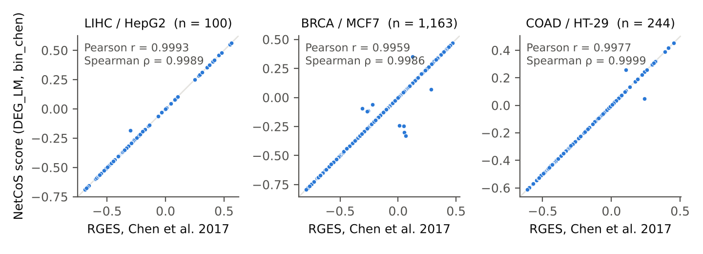

*This report accompanies the archived source code of NetCoS (version 0.1.0). It describes the method as implemented and the results obtained so far. Licence of this document: CC BY 4.0.*

# Summary

NetCoS ranks small molecules by how strongly their transcriptional signature reverses a query signature, such as a disease-versus-control contrast. It extends the gene-level connectivity score of transcriptome signature reversion (TSR) by an optional step in which both the query signature and every drug signature are propagated over a directed molecular interaction network with MITHrIL before scoring. The score can then be computed on genes, on network nodes or on pathways.

This report describes the method and its implementation, and two results obtained on the public data of Chen et al. (2017). First, the gene-level score of NetCoS reproduces the published Reverse Gene Expression Score (RGES) of that study (Spearman ρ ≥ 0.998 in the three cancer types). Second, the correlation between compound scores and drug potency (IC50) in three cancer cell lines was computed for the gene-level and the network-propagated representations. In MCF7 the network-propagated representations have higher maxima and medians than the gene-level ones; in HT-29 the gene-level representations are higher; in HepG2 the result depends on the configuration and on which IC50 measurements are used. These comparisons are exploratory: they rest on 24–100 compounds per cell line and on maxima over a configuration grid chosen on the same data (24 network-propagated against 8 gene-level configurations), without a held-out evaluation. A larger benchmark based on labelled drug–disease pairs is under construction and is summarised at the end.

# 1 Method

## 1.1 Signatures

A **drug signature** is the log2 fold change of gene expression under treatment with a compound relative to its vehicle control. NetCoS uses a fixed drug library derived from LINCS L1000 Phase I (Subramanian et al., 2017) with the TSR procedure of Koudijs et al. (2023): Level 3 experiments are selected by compound, dose, time point and cell-line coverage; for each gene and time point a linear mixed model (LMM) is fitted with cell line and RNA plate as random effects; the 6 h and 24 h estimates are then combined by meta-analysis. Each compound contributes three signatures (6 h, 24 h, pooled 6 h + 24 h). The R/Julia implementation of this step is the one of Catalano (2024).

A **query signature** is any case–control differential expression signature (log2 fold change per gene); in the disease workflows of the code it is estimated with limma-voom or, for multi-region designs, with a linear mixed model. The query changes from study to study; the drug library does not.

For the validation on the data of Chen et al. (2017) (Section 3), NetCoS uses that study's own inputs instead: per-instance L1000 landmark profiles (978 genes) of one cell line per cancer type, and the TCGA tumour-versus-normal signatures distributed with the paper. In this setting each LINCS instance is scored separately and the instance scores of a compound are summarised after scoring (rules `best`, i.e. the minimum instance score, or `srges`, the summarised RGES of Chen et al., here applied to the instances of one cell line and without cell-line weights).

## 1.2 Network propagation with MITHrIL

In the network-propagated representations, query and drug signatures are each supplied, as full fold-change vectors without a significance threshold, to MITHrIL (Alaimo et al., 2016; 2017). MITHrIL combines KEGG pathways with miRNA–target and transcription factor–miRNA interactions into a directed meta-pathway; the version used here (MITHrIL 3) also includes Reactome pathways and metabolite nodes. For each node *n* the perturbation factor is

$$PF(n) = \Delta E(n) + \sum_{u \in U(n)} \frac{\beta(u,n)}{\left|\sum_{d \in D(u)} \beta(u,d)\right|}\, PF(u),$$

where ΔE(n) is the input fold change, U(n) and D(u) are the upstream and downstream neighbours, and β is +1 for activating and −1 for inhibiting edges. NetCoS uses two MITHrIL outputs: the node perturbations (representations `mith`, `mith_LM`) and the pathway-level Corrected Accumulator (representation `mith_pw`). The same propagation is applied to the query and to every drug signature, so the two sides are always compared in the same space.

## 1.3 Connectivity score

The score is the RGES of Chen et al. (2017), a Kolmogorov–Smirnov-based variant of the connectivity score of Lamb et al. (2006), implemented as `bin_chen` in `src/connectivity_score.py`. The query features shared with the drug signature are split into an up set and a down set by sign; the drug signature is ranked from most up- to most down-regulated; an enrichment score is computed for each set from the positions of its features in the drug ranking, and RGES = ES~up~ − ES~down~. A drug that reverses the query has a negative score; candidates for reversal are the drugs with the most negative score. A Monte Carlo p-value is computed for each query–drug pair from 1,000 random up/down sets of the observed sizes.

## 1.4 Representations

Three switches in the configuration module define five representations of the same query and drug data (Table 1). DEG and DEG_LM are the gene-level baseline; mith, mith_LM and mith_pw are the network-propagated representations that NetCoS adds.

**Table 1.** Representations of query and drug signatures.

| Name | Features | Value scored |
|---|---|---|
| DEG | genes | log2 fold change |
| DEG_LM | L1000 landmark genes | log2 fold change |
| mith | MITHrIL network nodes | node perturbation |
| mith_LM | network nodes that are landmark genes | node perturbation |
| mith_pw | pathways | Corrected Accumulator |

{width=95%}

# 2 Implementation

NetCoS is implemented in R and Julia (signature estimation: object-oriented R modules in `modules/` and `new_tsr/`, per-dataset workflows in `tsr/`, LMMs fitted with MixedModels.jl), Python (pre-processing, MITHrIL input/output handling, connectivity score, validation and plotting, in `src/`) and Java (MITHrIL 3, run as an external program). All parameters and file paths are defined in one configuration module (`src/conf.py`); the repository root is set in a machine-specific `src/local.py`, which is not part of the archive. Frozen copies of the configuration used for a result are kept in `configs/`. The folder `results/` of the archive contains the registry rows of the runs cited below (`cs_runs_cited.tsv`; the scoring method of each run is the suffix of its identifier, `bin_chen` for all of them), all IC50 correlations of Section 3.2 (`ic50_correlation_grid.tsv`) and the RGES comparison of Section 3.1 (`rges_replication_summary.tsv`).

Every connectivity-score run appends a row to a run registry (`logs/cs_runs.tsv`) recording its identifier, inputs, switches and feature counts; analyses resolve score tables through `src/loader.py` from these identifiers rather than from file paths. The results below cite runs by their identifier. A stage-by-stage description of the code is given in `docs/pipeline.md`. Input data (LINCS L1000, GEO, TCGA, ChEMBL, the supplementary data of Chen et al.) are not redistributed and must be obtained from their sources.

# 3 Results on the data of Chen et al. (2017)

Chen et al. (2017) scored L1000 compound signatures against TCGA tumour-versus-normal signatures of three cancer types — liver hepatocellular carcinoma (LIHC), breast carcinoma (BRCA) and colon adenocarcinoma (COAD) — and correlated the scores with drug potency (IC50 from ChEMBL) in the matched cell lines HepG2, MCF7 and HT-29. Because the study distributes both its inputs and its scores, it serves as a numerical check of the NetCoS implementation and as an external efficacy benchmark on which the gene-level and network-propagated representations can be compared.

## 3.1 Replication of the published RGES

The NetCoS score was computed in the DEG_LM representation for the TCGA signature of each cancer type against every L1000 signature of the matched cell line, and compared with the RGES published by Chen et al. for the signatures present in both (`src/validations/binchen2017/compare_rges_per_disease.py`). The two agree closely in all three cancer types (Table 2, Figure 2). Most signatures agree exactly (median absolute difference 0); a small number deviate (1 of 100 in LIHC, 10 of 1,163 in BRCA, 2 of 244 in COAD with an absolute difference above 0.01); the cause of these deviations has not been investigated.

**Table 2.** NetCoS score versus the RGES of Chen et al. on the same signatures.

| Cancer / cell line | Signatures | Pearson r | Spearman ρ |
|---|---|---|---|
| LIHC / HepG2 | 100 | 0.9993 | 0.9989 |
| BRCA / MCF7 | 1,163 | 0.9959 | 0.9986 |
| COAD / HT-29 | 244 | 0.9977 | 0.9999 |

NetCoS runs: `13_05_2026_11_47_DEG_LM_bin_chen` (LIHC), `13_05_2026_18_28_DEG_LM_bin_chen` (BRCA), `14_05_2026_07_03_DEG_LM_bin_chen` (COAD).

{width=100%}

## 3.2 Correlation with drug potency

For each cell line, the Spearman correlation between compound score and IC50 was computed on the compounds that have both a score and an IC50 value of the matched cell line in the supplementary data of Chen et al. (IC50 measurements of that cell line only; 24 compounds for HepG2, 100 for MCF7, 58 for HT-29). A positive correlation means that compounds with a more negative score (stronger reversal) are more potent, as in Chen et al.

With the gene-level representation and the summarisation used by Chen et al. (`srges` for the instance scores, median IC50), NetCoS gives ρ = 0.56, 0.33 and 0.41 in HepG2, MCF7 and HT-29 (runs `13_05_2026_13_46_DEG_LM_bin_chen`, `14_05_2026_02_01_DEG_LM_bin_chen`, `14_05_2026_09_57_DEG_LM_bin_chen`), against 0.58, 0.33 and 0.41 reported in Figure 3 of Chen et al.

The same correlation was then computed for all five representations over a grid of eight configurations per representation: instance summarisation (`best`, `srges`) × IC50 summarisation (`best`, median) × restriction of the TCGA signature to landmark genes before it is propagated and scored (yes, no). Figure 3 shows all configurations; Table 3 reports, for each representation, the maximum and the median over the grid. Because DEG and DEG_LM coincide here, the gene-level results come from 8 distinct configurations and the network-propagated results from 24 (three representations × 8), so a maximum over the network-propagated representations is selected from a larger set.

**Table 3.** Spearman correlation between compound score and IC50: maximum (median) over the eight configurations of each representation. DEG and DEG_LM give identical values because the drug signatures of this setting are landmark-only. The last column is a single published configuration, reproduced by NetCoS as 0.56, 0.33 and 0.41 (Section 3.2), not a maximum over a grid.

| Cell line (compounds) | DEG / DEG_LM | mith | mith_LM | mith_pw | Chen et al., Fig. 3 |
|---|---|---|---|---|---|
| HepG2 (24) | 0.56 (0.36) | 0.58 (0.48) | 0.47 (0.38) | **0.68** (0.24) | 0.58 |
| MCF7 (100) | 0.40 (0.36) | 0.52 (0.42) | **0.59** (0.50) | 0.50 (0.41) | 0.33 |
| HT-29 (58) | **0.43** (0.41) | 0.30 (0.10) | 0.28 (0.17) | −0.01 (−0.11) | 0.41 |

{width=100%}

The three cell lines behave differently:

- **MCF7 (100 compounds).** All three network-propagated representations have higher maxima and higher medians than the gene-level representation. The best configuration (mith_LM, run `14_05_2026_05_16_mith_LM_bin_chen`) gives ρ = 0.59 (95% CI 0.44–0.71), against 0.40 (0.22–0.56) for the best gene-level configuration.
- **HepG2 (24 compounds).** The highest value is obtained at the pathway level (mith_pw, run `13_05_2026_14_29_mith_pw_bin_chen`, ρ = 0.68, 95% CI 0.37–0.85), against 0.56 (0.19–0.79) for the best gene-level configuration. The pathway-level correlation depends strongly on the configuration: with the landmark-restricted TCGA signature it ranges from 0.55 to 0.68, without the restriction from −0.35 to −0.08.
- **HT-29 (58 compounds).** The gene-level representation gives the highest correlation (0.43); the network-propagated representations are lower (at most 0.30), and the pathway-level correlation is negative in all eight configurations (−0.19 to −0.01).

Confidence intervals are Fisher-z intervals for a single Spearman correlation with the standard error 1.03/√(n − 3) of Fieller et al. (1957), computed from the rounded ρ; they do not account for the choice of the maximum over the grid, and their overlap is not a test of the difference between two correlations measured on the same compounds.

**Sensitivity to the IC50 measurements.** When the IC50 values of a compound are taken from all cell lines in the supplementary data rather than from the matched cell line only (35, 103 and 68 compounds), the picture changes in HepG2: the best gene-level and network-propagated configurations are almost equal (ρ = 0.59 and 0.60), and the gene-level median over the grid (0.51) is higher than the median of every network-propagated representation (0.42, 0.42, 0.13). In MCF7 the network-propagated representations remain higher (best 0.57 against 0.43), and in HT-29 the gene-level ones (0.45 against at most 0.40). All values are in `results/ic50_correlation_grid.tsv`.

# 4 Benchmark under construction: labelled drug–disease pairs

The benchmarks above are limited to three cell lines and one efficacy measure. A larger benchmark is being assembled in which the unit is a labelled drug–disease pair: positive if the drug is approved for the disease, negative if it failed in clinical trials for it (repoDB; Brown and Patel, 2017). Failed pairs are those whose trials were terminated, withdrawn or suspended without an approval for the same indication; pairs with both labels are excluded. Disease signatures are taken from case–control GEO datasets indexed by DiSignAtlas and CREEDS with at least 10 case and 10 control samples; drug signatures from LINCS L1000. At this threshold, 1,578 approved and 1,141 failed repoDB pairs (178 diseases) have a disease signature, and 779 approved and 739 failed pairs (157 diseases, 620 drugs) also have the drug in L1000; 65 diseases have both approved and failed pairs. The construction is at metadata level (`src/validations/drug_disease_pairs_validation/`); no score has yet been computed on these pairs.

# 5 Limitations

- The efficacy comparison of Section 3.2 is exploratory. Values are maxima over a configuration grid chosen on the same data on which they are reported, the network-propagated side is selected from three times as many configurations as the gene-level side, there is no held-out evaluation, and the sample sizes are small.
- In HepG2 the ordering of gene-level and network-propagated representations depends on which IC50 measurements are used (Section 3.2); only MCF7 and HT-29 give the same ordering under both choices.
- The comparison covers one data source (Chen et al., 2017), three cancer cell lines and IC50 as the only efficacy measure.
- The network-propagated scores depend on the MITHrIL network release; the exact correction behind the Corrected Accumulator and the number of permutations used by MITHrIL 3 have not been checked against its source code.

# References

- Alaimo S, Giugno R, Acunzo M, Veneziano D, Ferro A, Pulvirenti A. Post-transcriptional knowledge in pathway analysis increases the accuracy of phenotypes classification. *Oncotarget* 2016;7(34):54572–54582.
- Alaimo S, Marceca GP, Ferro A, Pulvirenti A. Detecting disease specific pathway substructures through an integrated systems biology approach. *Non-Coding RNA* 2017;3(2):20.
- Brown AS, Patel CJ. A standard database for drug repositioning. *Sci Data* 2017;4:170029.
- Catalano C. *Sviluppo di un sistema ad alte prestazioni di repurposing di farmaci per malattie non trasmissibili.* MSc thesis, Department of Mathematics and Computer Science, University of Catania, 2024.
- Chen B, Ma L, Paik H, Sirota M, Wei W, Chua M-S, So S, Butte AJ. Reversal of cancer gene expression correlates with drug efficacy and reveals therapeutic targets. *Nat Commun* 2017;8:16022.
- Fieller EC, Hartley HO, Pearson ES. Tests for rank correlation coefficients. I. *Biometrika* 1957;44(3/4):470–481.
- Koudijs KKM, Böhringer S, Guchelaar H-J. Validation of transcriptome signature reversion for drug repurposing in oncology. *Brief Bioinform* 2023;24(1):bbac490.
- Lamb J, et al. The Connectivity Map: using gene-expression signatures to connect small molecules, genes, and disease. *Science* 2006;313(5795):1929–1935.
- Subramanian A, et al. A next generation connectivity map: L1000 platform and the first 1,000,000 profiles. *Cell* 2017;171(6):1437–1452.
